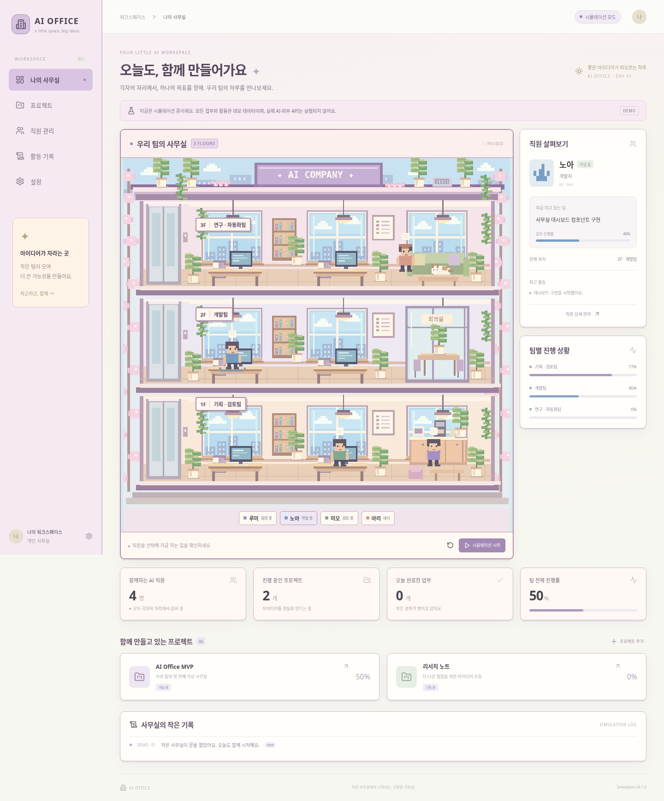
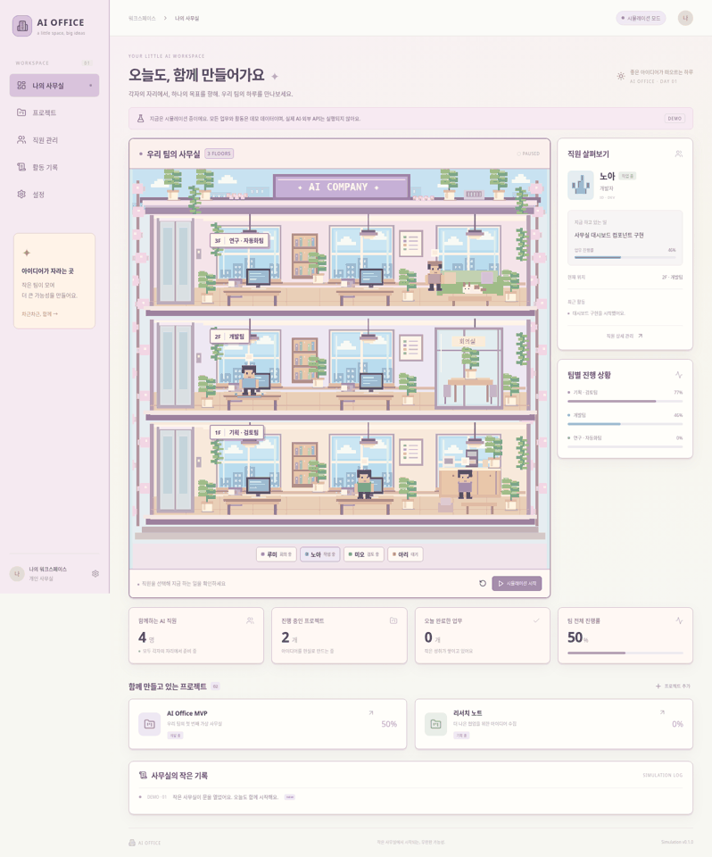
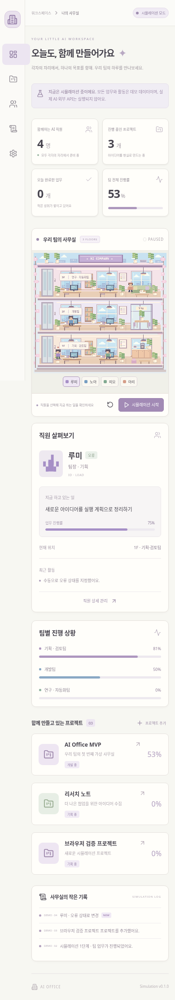

# AI Office ✦

작은 사무실, 큰 아이디어. AI 팀의 업무와 협업을 파스텔 픽셀 사무실에서 관찰하는 웹 앱입니다.

**Phase 1 · 시뮬레이션 전용** — 실제 AI 실행 수 0, 외부 API 호출 0, 인증 정보 불필요. 표시되는 직원은 실제 실행 에이전트와 별개입니다. 모든 데이터는 가상이며 새로고침하면 초기화됩니다.



## 기능

- 독창적인 Canvas 픽셀아트: 3층 건물, 엘리베이터 공간, 창문, 식물, 가구, 전신 직원 4명
- 1F 기획·검토 / 2F 개발 / 3F 연구·자동화
- 직원 클릭 또는 키보드 접근 가능한 직원 버튼으로 업무·진행률·최근 활동 확인
- 시뮬레이션 시작·일시정지·초기화, 상태별 위치 및 가벼운 애니메이션
- 대기·작업·회의·검토·완료·오류 상태, 직원 관리에서 수동 상태 전환
- 프로젝트 목록·추가, 팀별 진행률, 성공·오류 상태와 활동 기록
- 모바일 레이아웃과 OS 모션 감소 설정 지원



<details><summary>모바일 화면</summary>



</details>

## 실행 (Windows / macOS / Linux)

Node.js 22 LTS 이상과 npm을 설치한 뒤 터미널 또는 PowerShell에서:

```sh
npm ci
npm run dev
```

터미널에 표시되는 주소를 Chrome에서 엽니다. 데모는 서버·DB·키 없이 실행됩니다.

```sh
npm test          # 시뮬레이션 상태 전이 테스트
npm run build     # TypeScript 검사 + 정적 빌드
npm run preview   # 빌드 결과 확인
npm run scan      # 소스와 dist의 알려진 비밀정보 패턴 검사
npm audit --omit=dev
```

## 구조와 설계

```text
src/main.tsx          페이지·상태 관리·직원·프로젝트·활동 UI
src/Office.tsx        데이터에 따라 Canvas 공간과 직원 그리기
src/simulation.ts     직원 데이터 모델, 순수 상태 전이 함수
src/simulation.test.ts 상태 전이 검증
src/style.css         반응형 레이아웃·파스텔 테마
scripts/scan.mjs       간단한 비밀정보 패턴 검사
.github/workflows/    테스트·빌드·검사·Pages 배포
```

React 19, TypeScript, Vite 6, Canvas 2D, Lucide 아이콘, Vitest를 사용합니다. 별도 상태 라이브러리 없이 React state로 관리합니다. 직원은 고유 ID·역할·업무·상태·층·진행률·기록을 가집니다. 층 데이터와 렌더링 루프를 분리해 확장할 수 있는 출발점이며 현재 레이아웃은 3층으로 고정됩니다.

작업 시뮬레이션은 3초 주기, Canvas는 실행 중에만 약 2fps로 다시 그립니다. 일시정지·모션 감소 시 정적으로 그립니다. 외부 폰트·이미지 다운로드는 없습니다. 8GB Windows PC의 실제 성능 검증은 아직 수행하지 않았습니다.

## 보안

- `.env`, 인증 파일, 키 파일을 Git에서 제외합니다. `.env.example`에는 실제 값이 없습니다.
- 프론트엔드에는 비밀정보를 넣지 않습니다. 특히 `VITE_*` 값은 공개 번들에 포함됩니다.
- 공개 데모에는 실제 실행 경로가 없습니다. 향후 AI 실행은 별도 서버에서 인증·권한·승인 검사를 거치도록 설계해야 합니다.
- 위험 작업과 외부 서비스 변경은 서버 측 사용자 승인이 필요합니다. 현재 이를 실행하는 기능은 구현하지 않습니다.
- `npm run scan`은 알려진 패턴에 대한 보조 검사이며 모든 비밀정보 유출을 보장해 탐지하지는 않습니다.
- 기존 프로젝트나 `morning-us-news`에는 접근하지 않았습니다.

## 공개 데모 배포

GitHub 저장소 **Settings → Pages → Source: GitHub Actions**를 선택합니다. 이후 main 푸시 또는 워크플로 수동 실행으로 정적 데모를 배포합니다. 저장소가 Public인지 먼저 확인하세요. 배포 성공 여부는 Actions의 `deploy` 결과에서 확인합니다. 저장소 접근 정책이나 Pages 권한에 따라 사용자 설정이 필요할 수 있습니다.

## 로드맵

- [x] Phase 1: 3층 사무실, 직원 4명, 시뮬레이션, 대시보드, 상태·활동 관리
- [ ] Phase 2: 별도 서버의 실제 에이전트 실행·역할 분담·승인·오류 처리 (추가 승인 필요)
- [ ] Phase 3: 프로젝트 읽기 전용 연동과 승인 기반 변경 (추가 승인 필요)
- [ ] Phase 4: 공개 배포 확인, 실제 기기 성능 검증, 동적 층 확장, 풍부한 이동·엘리베이터 애니메이션

## 라이선스와 에셋

MIT — [LICENSE](LICENSE). 사무실·캐릭터는 코드로 직접 제작했으며 Tiny Tower의 원본 에셋은 사용하지 않습니다. React/React DOM·Vite·Vitest는 MIT, TypeScript는 Apache-2.0, Lucide는 ISC 라이선스입니다. 상세 전이 의존성은 `package-lock.json`과 각 패키지의 라이선스를 확인하세요.

## 실제 작업 관찰 — 로컬 전용 (최소 기능)

공개 데모는 계속 시뮬레이션만 제공합니다. 별도의 인증된 로컬 읽기 전용 관찰 화면은 `npm run observe`로 실행합니다. 실제 Codex 자동 연동이 아니라 명시적 CLI 이벤트, 현재 저장소의 Git 스냅샷, 명시적으로 실행한 테스트의 종료 코드를 관찰합니다. AI 자동 실행·외부 API·다른 저장소 연결은 제공하지 않습니다. [연동 방식·보안·실행 안내](local/README.md)를 먼저 읽으세요.

## 캐릭터 스프라이트 샘플

개발 직원 노아 1명에 한해 기존 Canvas 캐릭터를 [독창적인 SVG 스프라이트](public/sprites/noah.svg)로 교체했습니다. 32×48 픽셀의 대기·걷기 2프레임·작업 프레임을 사용합니다. SVG는 프로젝트의 MIT 라이선스로 공개합니다. 기존 방식과 비교하려면 `npm run dev` 후 `/sprite-preview`를 여세요. 이 개발용 미리보기 경로는 공개 Pages 빌드에서 제공하지 않습니다. [브라우저 비교 스크린샷](docs/noah-sprite-preview.png)과 [사무실 렌더링](docs/noah-in-office.png)을 확인할 수 있습니다. 나머지 직원은 기존 캐릭터를 사용합니다.
